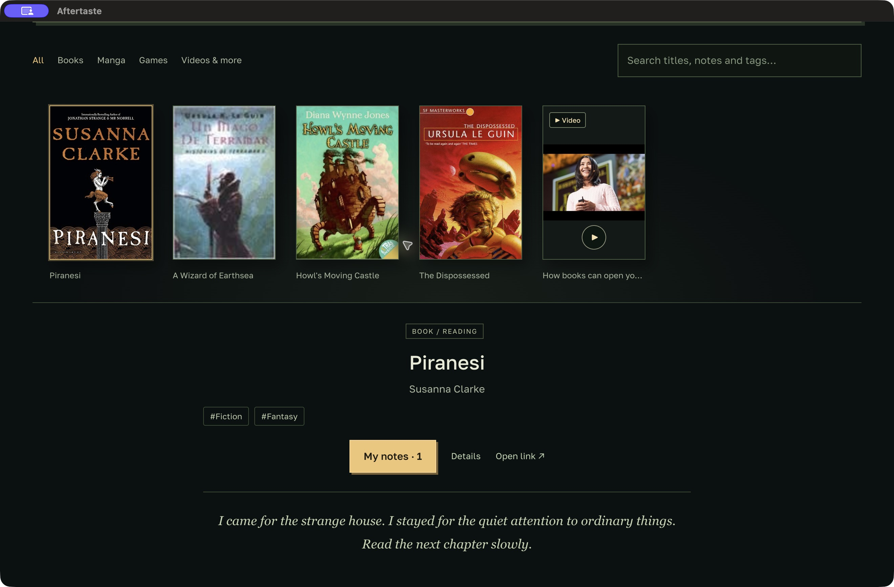

# Aftertaste

**Read. Watch. Take notes.**

A local desktop library for books, manga, games, videos and your notes. Search catalogs, save covers, record written or voice notes, find them later and keep a backup. **No account is needed.**


[Download](https://github.com/ansvier/aftertaste/releases/tag/v0.3.2) · [Getting started](docs/GETTING_STARTED.md) · [Privacy](docs/PRIVACY.md) · [Optional ChatGPT connection](docs/CHATGPT.md)



*Example library and notes. Every new installation starts empty.*

## What you can do

- Search books through Open Library / Google Books, manga through MangaDex and games through Steam. Add other material by link or manually; upload a cover when needed.
- Keep reading / watching / playing status, written notes and local voice recordings.
- Search titles, authors, note text and tags. Open a matching note directly from its excerpt.
- Get automatic topic tags from titles, descriptions and notes, processed locally without an AI account. You can also add your own tags.
- Download and restore a full library backup, including covers, audio, notes and context. Local recovery copies are made before app updates, restores and deletions.
- Switch between **English 🇺🇸, Russian 🇷🇺 and French 🇫🇷**. Language choices persist. Project documentation, code and community communication remain in English.

The library, notes, search, tags, import and backups work without ChatGPT. Reading and writing local data also work offline. Public catalogs and remote cover images need internet access.

## Optional recommendations with ChatGPT

Connect your ChatGPT plan to discover books, manga or games based on chosen context and written notes. Available access and limits depend on your account, workspace and OpenAI's preview. No separate developer API key is needed; this is not unlimited or offline AI.

Import selected conversations or documents, or connect a trusted local chat assistant to update context and request recommendations without moving files around. Signing in does **not** provide ChatGPT history access. Context and recommendations update only when requested. See [local chat setup](docs/LOCAL_CHAT.md).

The first ChatGPT connection copies an existing offline library into the new account library, including media. The original offline library remains available. Existing account libraries are never replaced. Signing out keeps access to the account's saved library and notes.

## Download

Get **Aftertaste 0.3.2 — public preview** from [GitHub Releases](https://github.com/ansvier/aftertaste/releases/tag/v0.3.2).

| System | Download |
| --- | --- |
| macOS, Apple silicon | `Aftertaste-0.3.2-mac-arm64.zip` |
| macOS, Intel | `Aftertaste-0.3.2-mac-x64.zip` |
| Windows, x64 | `Aftertaste-0.3.2-win-x64.exe` (portable) |
| Linux, x64 | `Aftertaste-0.3.2-linux-x86_64.AppImage` |

The preview is unsigned and macOS builds are not notarized. Your system may warn or block first launch. See [installation notes](docs/GETTING_STARTED.md). SHA-256 checksums accompany the release. Updates are manual; application data is kept separately from the app bundle.

## Local data and privacy

The library is saved in the operating system's Aftertaste application-data folder. Each ChatGPT registration has a separate library, as does the account-free library. OAuth credentials stay in the desktop main process, encrypted through the system credential store. They are excluded from backups and local chat tools.

Enabled context and written notes go directly to OpenAI only when you request recommendations. Catalog searches send search terms to the catalog provider; remote covers load from their providers. Automatic tags are keyword-based, computed locally and recomputed as notes change. They are topic suggestions, not a psychological profile.

The library and its backups are **not encrypted by Aftertaste**. Keep backups private. There is no Aftertaste cloud account, telemetry, automatic cloud sync or scheduled recommendation process. See [privacy and data flow](docs/PRIVACY.md).

## Run from source

Requires Node.js 22 or newer and a supported desktop OS.

```sh
npm ci
npm test
npm run check
npm start
```

Build on the target OS with `npm run dist:mac`, `npm run dist:win` or `npm run dist:linux`. The desktop runtime has no npm production dependencies. Electron and electron-builder are development / packaging dependencies. No `.env` file or developer API key is needed.

See [development notes](docs/DEVELOPMENT.md) and [validation](docs/RELEASE_VALIDATION.md). An isolated development launch can set `AFTERTASTE_TEST_DATA_DIR` to an existing absolute directory; this override is ignored in packaged apps.

## Preview boundaries

Catalog metadata and covers vary. AI can misunderstand context. Automatic tags cover a limited set of explicit topics; they are not a semantic classifier. Context imports support text / Markdown, ChatGPT JSON exports and Aftertaste context exports, not PDF / DOCX / ZIP. Voice notes are recorded and played locally; they are not transcribed or sent to AI. There is no mobile build or automatic updater.

## Contribute

Please use English for issues, pull requests and documentation. Translation strings live in `renderer/locales/`; keep all dictionaries' keys and interpolation fields aligned. Read [CONTRIBUTING.md](CONTRIBUTING.md) and [SECURITY.md](SECURITY.md). Never attach private conversations, account tokens or library backups to a public issue.

MIT-licensed. Fonts and bundled components retain their own licenses; see [notices](THIRD_PARTY_NOTICES.md). Independent project, not affiliated with OpenAI, Internet Archive, Google, MangaDex or Valve.
